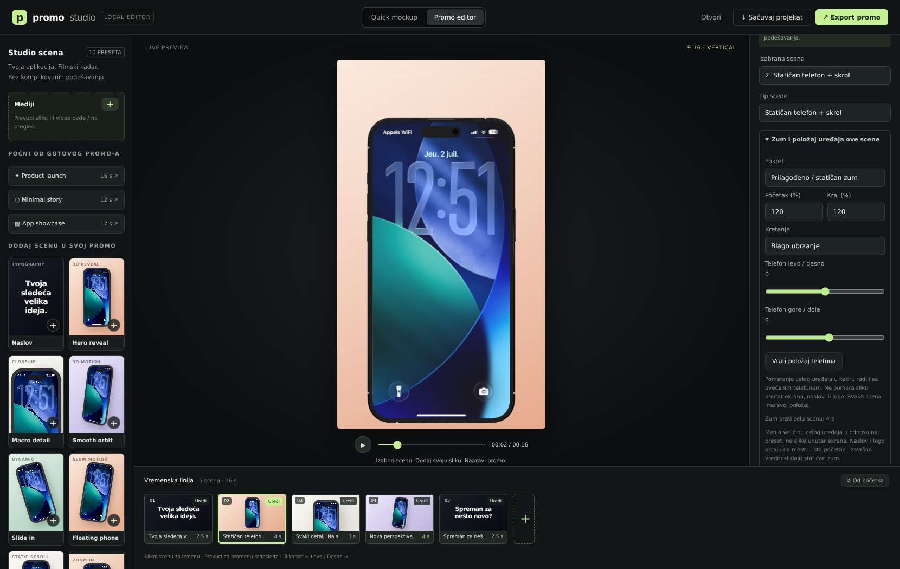
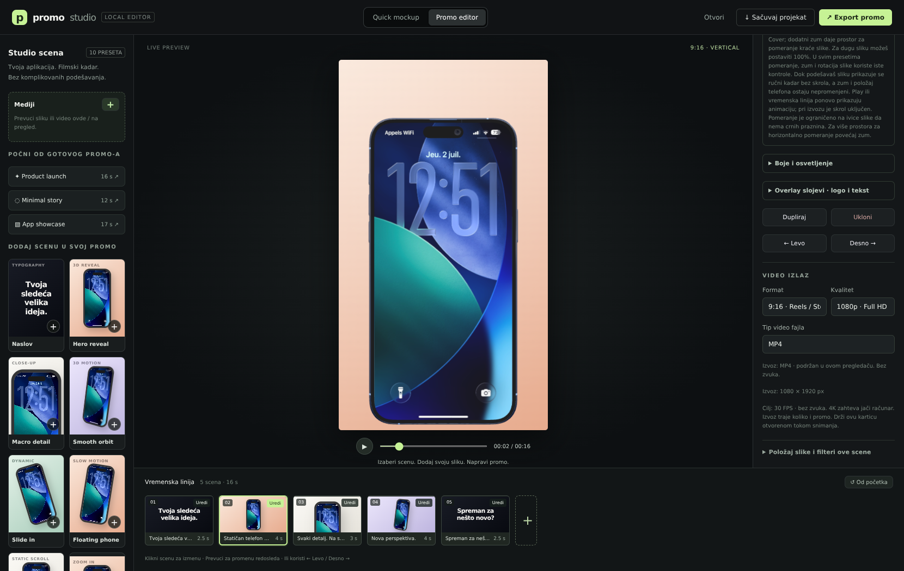
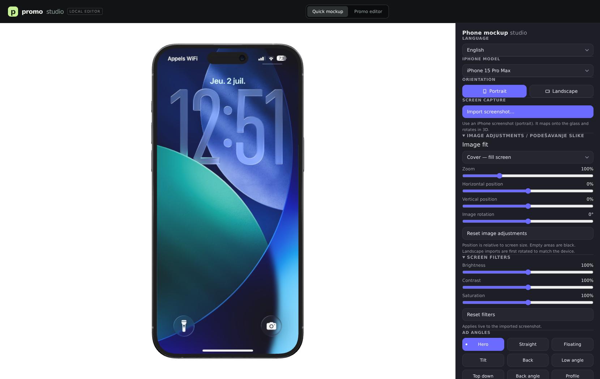

<h1 align="center">Phone Mockup Studio</h1>

<p align="center">Turn screenshots and screen recordings into multi-scene promo videos, or create a 3D phone mockup and export a transparent PNG. Everything renders locally in your browser.</p>

<p align="center"><strong>10 scene presets · MP4 / WebM · Native 4K · Portable projects</strong><br>No account, no watermark, no build step.</p>

<p align="center">
  
</p>

<p align="center"><sub>Actual screenshots of the current application, captured from a local server. UI labels below match the editor.</sub></p>

## Start here

### Windows — one click

1. [Download the project ZIP](https://github.com/Blagii/phone-mockup-studio/archive/refs/heads/main.zip) and **extract the entire archive into a new folder**.
2. Install **Python 3** if needed. Enable **Add Python to PATH** during installation.
3. Double-click **`START-STUDIO.bat`** in the extracted folder.
4. The launcher opens the application in your browser. **Keep its terminal window open.** Stop the server with **Ctrl+C**.

Do **not** open `index.html` by double-clicking it, run the app inside the ZIP, or mix files from different versions. Serbian startup instructions are also included in [POKRETANJE.txt](POKRETANJE.txt).

### macOS / Linux, or a terminal on Windows

Run from the project folder:

```bash
python3 serve.py --open
# Windows: py -3 serve.py --open
```

The default address is **http://localhost:8780**. If that port is occupied, the launcher selects another available port and prints/opens the correct address. Always use the address shown in the terminal.

- No npm or pip installation is needed to **run** the app.
- Three.js and all required runtime modules are bundled in `vendor/three/`; after downloading the project, runtime internet access is not required.
- The server verifies required files, serves from its own project directory, sets correct JavaScript MIME types and prevents stale application-code caching.
- Optional arguments: `--port 8800` or `--bind 0.0.0.0` to allow access from other devices on your network.
- Chrome or Edge is recommended for desktop editing and recording. Encoder availability depends on your browser and operating system.

## Current interface

The default workspace is **Promo editor**: presets and media on the left, a live preview in the center, scene settings on the right, and a timeline below. **Quick mockup** opens the original free-rotation editor without discarding your promo project.

Click an image to view it at full resolution.

<table>
  <tr>
    <td width="50%"><a href="screenshots/scene-controls.png"></a><br><strong>Device zoom and positioning</strong></td>
    <td width="50%"><a href="screenshots/phone-case.png"></a><br><strong>Frame colors and finishes</strong></td>
  </tr>
  <tr>
    <td width="50%"><a href="screenshots/video-export.png"></a><br><strong>Explicit MP4 / WebM export</strong></td>
    <td width="50%"><a href="screenshots/quick-editor.png"></a><br><strong>Quick mockup workspace</strong></td>
  </tr>
</table>

## Make a promo video

1. Choose **Product launch**, **Minimal story**, or **App showcase**, or add individual scene presets.
2. Click **Slika / video za ovu scenu** or drag a file onto the workspace. Each scene can use a different image or screen recording. Reuse imported assets from the media library.
3. Select a scene on the timeline or in **Izabrana scena**. Edit its text, duration, palette, device, media, animation and overlays independently.
4. Preview with **Play** or scrub the timeline. Add, duplicate, remove, drag to reorder, or move scenes using the left/right buttons.
5. Under **Video izlaz**, choose an aspect ratio, resolution and **MP4** or **WebM**, then click **Export promo**.

### Ten scene presets

| Preset | What it does |
| --- | --- |
| Naslov | Title card with editable text and optional image/video behind it; no device. |
| Hero reveal | Introduces the device with a 3D reveal. |
| Macro detail | Close-up framing with a cinematic move. |
| Smooth orbit | Moves smoothly between two 3D angles. |
| Slide in | Brings the device into the frame diagonally. |
| Floating phone | Gentle floating motion and rotation. |
| Statičan telefon + skrol | Keeps the phone facing forward and still, with image scrolling enabled. |
| Zumiranje | Zooms the device in over the scene. |
| Odzumiranje | Zooms the device out over the scene. |
| Poziv na akciju | Closing title/link card with optional background media. |

Scenes last **1–120 seconds**; the timeline supports up to **36 scenes**. Choose **Soft fade** or **Cut** transitions. New static-scroll scenes default to 8 seconds with no title text and a cut transition.

### Image adjustment versus device position

These are separate controls:

- **Položaj slike i filteri ove scene** changes the image *inside* the device: zoom, horizontal/vertical position, rotation, cover/contain fit, brightness, contrast and saturation. In title scenes it adjusts the background media instead.
- **Zum i položaj uređaja ove scene** changes the *whole device*: 25–250% starting/ending zoom, easing, and left/right and up/down position. Equal zoom values give a static zoom. Position controls preserve the current preview time and zoom. **Vrati položaj telefona** resets only the device offset.

Image settings, device position, text styling and animations are stored independently for each scene. Duplicating a scene creates independent settings; changing one scene does not change the others. Quick mockup retains its own image settings.

### Automatic image scrolling

Open **Automatski skrol slike** to enable scrolling, choose down/up and linear/smooth movement, and adjust extra zoom. It traverses the complete image overflow over the scene duration: **down starts at the exact top; up starts at the exact bottom**. Manual vertical cropping does not skip the beginning of the animated scroll. Cover-fit and bounded placement prevent exposed black edges, including with rotation.

While adjusting an image, the paused preview shows the normal manual crop. **Prikaži skrol i dok je video pauziran** explicitly switches to the animated crop at the current timeline time. Play and timeline seeking preview the animation; selecting a scene restores its saved manual crop. Pressing Play after manual editing of a scrolling scene restarts that scene at the beginning. Export always uses the animated scroll path when scrolling is enabled.

### Titles, subtitles and overlays

- Each scene has its own title, subtitle, font, alignment, vertical text position and visibility toggles.
- Under **Izgled teksta ove scene**, **Veličina podnaslova** independently scales the subtitle from **25–500%**. **Podnaslov kao naslov** uses the title's base size, bold weight and color.
- In **Naslov** and **Poziv na akciju**, **Dodaj sliku u naslovnu scenu** adds media behind the text without a phone. Removing it affects only that scene, not the asset library or other scenes.
- Add up to **eight text/image overlay layers** per scene, including transparent PNG logos. Adjust position, size, rotation, color, opacity and visibility times, or drag the overlay directly on the preview. Selection guides are not exported.

### Devices and frame styling

Promo scenes support the detailed **iPhone** model, a procedural **Samsung / Android-style** phone, **Laptop**, or **Samo ekran**. The Android-style device is a procedural representation, not the detailed Samsung GLB used in Quick mockup.

In **Maskica / okvir telefona**, choose **Originalni okvir**, **Mat maskica**, **Sjajna maskica**, or **Metalni okvir**, plus a ready-made or custom color. These options style the existing frame's color/material finish; they do not add a separate protective-case mesh. Frame settings are scene-local and included in video export. Background gradient, text/accent colors and lighting tint/intensity can also be customized independently.

## Export MP4 or WebM

Under **Video izlaz → Tip video fajla**, choose **MP4** or **WebM**. There is **no automatic format selection**. WebM is the default; the choice is saved in the project.

- The selected container must be supported by the browser/OS. Unsupported formats show a clear message instead of silently switching or changing a file extension.
- MP4 uses the browser's native encoder; no online conversion service is used.
- Aspect ratios: **9:16**, **1:1**, **16:9**.
- Quality: **720p**, **1080p**, or native **4K**: 2160×3840 portrait, 2160×2160 square, 3840×2160 landscape.
- Export records the complete composition, including device animation, media, text, overlays and transitions. It is **silent**, runs in **real time**, and targets **30 FPS**. Performance depends on the GPU, browser and encoder.
- **Keep the tab visible** while recording. Switching away cancels the recording. Export can also be cancelled explicitly without discarding your project.
- Preview resolution stays lightweight; export allocates the chosen native dimensions. If recording fails or the GPU cannot support the size, try 1080p or 720p.

### Save and reopen projects

**Sačuvaj projekat** produces a portable JSON file containing scenes, media, overlays, colors, frame finishes, typography, image/device adjustments and output settings. **Otvori** restores it. Version 1 projects remain supported. Files are local, not stored in a cloud account.

A **Spremno za preuzimanje** panel retains separate **Preuzmi projekat** and **Preuzmi promo video** links. If the browser blocks an automatic download, click the corresponding link. Links remain available until replaced by a new file of that type or the page closes. Embedded previews also offer opening the app in a new tab if sandbox restrictions prevent downloads. Save/export controls are available on mobile too.

### Media limits

| Item | Limit / support |
| --- | --- |
| Image input | PNG, JPEG, WebP, GIF and AVIF |
| Video input | MP4, WebM and MOV when supported by the browser |
| Individual asset | 50 MiB |
| Media library | 32 assets / 120 MiB total |
| Portable project | 185 MB |
| Video playback | Muted, looping, with a per-scene start offset |

Media stays local. Project assets are decoded and validated before replacing the current project. Removing an asset clears references to it and associated image overlay layers.

## Quick mockup

The original editor remains available in **Quick mockup**:

- Detailed iPhone 15 Pro Max, iPhone 17 Pro Max, iPhone 17 Pro and Samsung Galaxy S25 Ultra models.
- Free 3D rotation, front/back/hero angle presets and live lighting.
- Image fit, crop, zoom, horizontal/vertical position, rotation and filters.
- Five ready-to-use motion presets, configurable spin/sway and video recording.
- Quick video: 1–60 seconds, 720/1080/1920 px long edge, 24/30/60 FPS; the browser determines the available recording container. The explicit MP4/WebM selector above belongs to Promo editor.
- Transparent PNG export for landing pages, app listings, Canva or Figma; native sharing on supported iOS browsers.
- Browser-language detection and switchable translations for Quick controls.

<details>
<summary>Example transparent PNG exports from Quick mockup</summary>
<p align="center">
  <a href="screenshots/mockup-portrait.png"></a>
  <a href="screenshots/mockup-landscape.png"></a>
</p>
</details>

## Troubleshooting

| Symptom | What to check |
| --- | --- |
| Blank page / `text/plain` module error | Extract the entire ZIP into a new folder and use `START-STUDIO.bat` or `serve.py`, not a generic server or `file://`. |
| Old UI appears after an update | Stop the old server, use the newly extracted folder and launcher, close the old tab, and hard-refresh with Ctrl+Shift+R. |
| Missing files on startup | Confirm that `source/`, `vendor/` and the JavaScript files were extracted together. |
| MP4 or WebM not supported | Choose the other container or a browser/OS with the required encoder. |
| Download does not start | Use the persistent download link, or open the app outside the embedded preview. |
| Export fails or runs slowly | Keep the tab visible, close GPU-heavy apps and try 720p/1080p. |

Startup shows a loading screen until Promo editor is initialized, rather than briefly exposing Quick mockup. Genuine startup failures display instructions; unrelated script errors after initialization do not block a working editor. App code is refreshed network-first with an offline fallback; large models remain cache-first.

## Development and tests

The app is static HTML/CSS/ES modules. Node.js is only needed for the optional test suite; Python 3 is also used by local-server tests.

```bash
npm test
# or: node --test tests/*.test.cjs
```

Browser checks require Playwright in your test environment and a running server:

```bash
STUDIO_URL=http://localhost:8780 node tests/promo-browser.cjs
STUDIO_URL=http://localhost:8780 node tests/startup-browser.cjs
STUDIO_URL=http://localhost:8780 node tests/video-format-browser.cjs
```

Other suites cover image adjustments, scene isolation, scrolling, zoom/position, phone finishes, title images, typography, native 4K, portable projects, cancellation and blocked downloads. Browser suites accept `CHROMIUM_PATH` for a custom Chromium executable; `CHROMIUM_SERVERLESS=1` uses `@sparticuz/chromium` arguments when that package is installed. Environment-variable syntax above is for POSIX shells; use `$env:STUDIO_URL='http://localhost:8780'` first in PowerShell.

To refresh the real UI screenshots with Playwright:

```bash
STUDIO_URL=http://localhost:8780 node scripts/capture-screenshots.cjs
```

The script captures the current desktop workspace, device position controls, frame styling, export settings and Quick mockup at 1660×1050. It edits only the temporary browser session, not application defaults.

## Built with, credits and license

- [Three.js 0.160.0](https://threejs.org/) — WebGL rendering, `GLTFLoader`, `OrbitControls` and image-based lighting. Required modules are bundled locally under the MIT license; see [vendor/three/LICENSE](vendor/three/LICENSE).
- Bundled third-party 3D models retain their [CC BY 4.0](https://creativecommons.org/licenses/by/4.0/) licenses. Full attribution: [CREDITS.md](CREDITS.md).
- Application code: [MIT](LICENSE), originally © Quentin PLA. See the repository history for subsequent contributions.

Not affiliated with or endorsed by Apple or Samsung. Device trademarks belong to their respective owners. The scene presets are original compositions, not copies of external promo videos.
