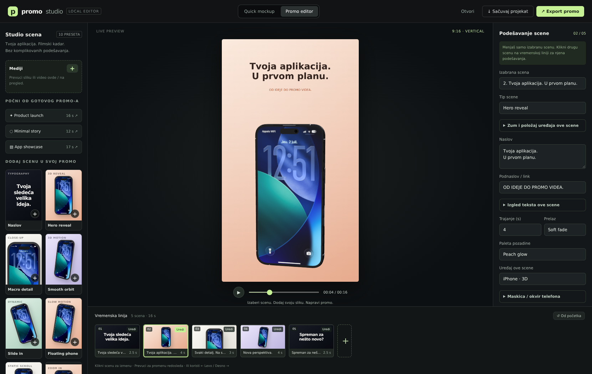

<p align="center">
  <a href="https://quentin-pla.github.io/phone-mockup-studio/"></a>
</p>

<h1 align="center">Phone Mockup Studio</h1>

<p align="center">Build a multi-scene promo video from your screenshot, or rotate a photorealistic 3D phone and export a transparent PNG — right in your browser. No signup, no watermark, no build step.</p>

<p align="center"><strong>▶ Live app: <a href="https://quentin-pla.github.io/phone-mockup-studio/">quentin-pla.github.io/phone-mockup-studio</a></strong></p>

<p align="center">
  <a href="https://quentin-pla.github.io/phone-mockup-studio/"></a>
  <a href="https://quentin-pla.github.io/phone-mockup-studio/"></a>
</p>

<p align="center"><sub>PNGs the app itself exported — mobile screenshots rendered onto an iPhone 15 Pro Max.</sub></p>

## Promo editor

The default workspace is a promo generator with a scene library, a central live preview, a scene inspector, and an editable timeline. The original editor remains available under **Quick mockup**.

1. Choose **Product launch**, **Minimal story**, or **App showcase**, or build your own sequence from nine scene presets.
2. Click **Slika / video za ovu scenu** or drag a file into the workspace. Each scene can have its own image or screen recording. Click an imported asset in the library to reuse it, or use **Primeni ovaj medij na sve scene**.
3. Click a scene on the timeline (or choose it in **Izabrana scena**) to edit only that scene’s title, subtitle/link, duration (1–120 seconds), palette, and fade/cut transition. Selection scrolls its inspector back to the text fields. Under **Izgled teksta ove scene**, independently set font, size, vertical position, alignment, and title/subtitle visibility. These settings are preserved in saved projects and use the same renderer in preview and export. Add, duplicate, remove, drag to reorder, or use the left/right buttons. Up to 36 scenes.
4. Preview or scrub the complete sequence. Choose 9:16, 1:1, or 16:9 and 720p, 1080p, or native 4K output (2160×3840 portrait, 3840×2160 landscape, 2160×2160 square). The preview stays lightweight; export uses the selected native resolution.
5. Click **Export promo** to download the entire composition: real 3D phone motion, background, typography, and transitions, rendered from the same timeline as the preview. Recording runs in real time at a target of 30 FPS and has no audio; keep the tab visible. Output is WebM or MP4 depending on browser support.

**Sačuvaj projekat** downloads a JSON project including scenes, all imported images/videos/logos, overlay layers, device/color/lighting settings, output settings, image adjustments, filters, and model selection. Version 1 projects remain supported. **Otvori** restores it. Projects are local files, not cloud storage. The layout also adapts to mobile screens.

### Media, devices and layers

- **Image and video input:** PNG, JPEG, WebP, GIF, AVIF, MP4, WebM, and MOV when the browser can decode them. Drag & drop or use the file picker. Each asset is limited to 50 MiB, the library to 32 assets / 120 MiB. Files stay local; nothing is uploaded. Browser-recorded WebM files without duration metadata are probed locally.
- **Per-scene content:** choose an asset independently for each shot, set a video start offset, and reuse assets across scenes. Videos are synchronized with the timeline, loop if needed, and are muted. Image position, zoom, rotation, fit mode and brightness/contrast/saturation are stored independently for each scene. The advanced controls restore the selected scene’s values; duplicating or resetting a scene does not change others. Preview and export read scene-local settings directly, and Quick mockup keeps its own settings. Legacy projects migrate their old global crop/filter values into separate per-scene copies.
- **Duration-synchronized screen scrolling:** under **Automatski skrol slike**, enable vertical scrolling for an individual scene, choose top-to-bottom/bottom-to-top and linear/smooth movement. The image traverses its full vertical overflow from the scene’s first frame to its last, with no independent speed or timer. Scrubbing, playback and export sample the same scene-time function. Scroll uses cover-fit plus an adjustable extra zoom (115% by default, 100% for long screenshots); manual position/filter settings remain stored. During automatic scrolling manual X/Y offsets are applied to the animated position and clamped to cover every screen corner, including with rotation or a low manual zoom, preventing black gaps at scene boundaries. Settings are saved and independently copied with the scene.
- **Scene/device zoom:** choose **Zumiranje** or **Odzumiranje** as a shot type, or open **Zum uređaja ove scene** on any device scene. Set 25–250% start/end scale and linear or smooth timing; equal values produce static scaling. Movement spans the full scene duration, is saved/copied independently, and leaves titles/logos and screen crop settings unchanged. This is an additional scale relative to the selected motion preset.
- **Devices:** the existing detailed GLB phone plus original procedural 3D Android, laptop (lid, keyboard, trackpad), and frameless screen options. Device selection is per scene. No external laptop model is needed.
- **Custom brand colors:** freely choose both gradient background colors, title/accent colors, lighting tint/intensity and device frame color per scene.
- **Overlay layers:** up to eight text/image layers per scene, including transparent PNG logos. Select a layer to edit its position, size, rotation, color, opacity and visibility interval. Drag it directly in the preview; selection guides never appear in exported video.
- **Native 4K:** the encoder receives the selected native canvas dimensions. 30 FPS is a target, not a guarantee: real-time encoding performance depends on GPU, codec and browser. Unsupported sizes and recording failures show an error rather than claiming success; select 1080p/720p if needed. Export has no audio.
- **Portable projects:** JSON embeds the media, so video projects may be large. The project file limit is 185 MB. Media is decoded and validated before replacing the current library; deleting an asset clears its scene references and linked image layers.

The scene presets are original motion compositions inspired by a promo-editor workflow, not copies of external video files.

## Features

- **Import a screenshot** — it maps straight onto the phone's screen, edge to edge (landscape shots are auto-rotated to fit).
- **Pick a model** — iPhone 15 Pro Max, 17 Pro Max, or 17 Pro.
- **Rotate freely** in 3D, or snap to one-click ad-angle presets (front, back, hero angles).
- **Adjust imported images** — cover/fit, zoom, horizontal/vertical position, and rotation with a one-click reset.
- **One-click video presets** — full 360° turn, slow 360° turn, hero sway, tilt, and gentle roll. Each configures motion, duration, 1080 px, and 30 FPS and starts a preview; then click Export video. Your image and framing stay unchanged.
- **Adjustable animation** — spin or gentle sway, X/Y/Z axis, speed, and sway angle. Use the auto-spin button to preview.
- **Export video** — 1–60 seconds, 720/1080/1920 px long edge, and 24/30/60 FPS. Uses native browser recording: WebM (VP8 preferred for reliable encoding), or MP4 depending on browser support. Records the current viewport framing and scene background (no audio); keep the tab visible. Recording can be cancelled, and the original view is restored afterward.
- **Live screen filters** — brightness, contrast, saturation, applied in real time.
- **Export a transparent PNG** ready for landing pages, App Store shots, or ads.
- **Save to Photos on iOS** via the native share sheet.
- **Multi-language UI** — auto-detected from your browser (English, French, Spanish, German, Italian, Portuguese, Japanese, Chinese), switchable anytime.
- **Works offline** once loaded — pure client-side Three.js.

## Built for content creators

Making a marketing page, a Canva design, or a Figma mockup for your app? A flat screenshot never looks as good as a screenshot *in a phone*. Phone Mockup Studio exports high-resolution, transparent PNGs you can drop straight into any design tool:

- **Canva & Figma ready** — transparent background means it drops onto any layout, color, or gradient with zero editing.
- **High-res output**, sized to look sharp on retina displays and large marketing banners alike.
- **No design skills needed** — pick an ad-angle preset and export; the lighting, reflections, and framing are already done for you.
- **Free and unlimited** — no per-export watermark, no paid tiers, no account.

## Usage

Open the [live app](https://quentin-pla.github.io/phone-mockup-studio/), choose a model, import your screenshot, frame the shot, and hit export.

### Run locally (Windows: one click)

1. Download this version and **extract the entire ZIP into a new folder**. Do not run inside the ZIP or mix old/new files.
2. On Windows, double-click **START-STUDIO.bat**. Python 3 must be installed; no npm or pip installation is needed.
3. The launcher opens the correct local address automatically. Keep its terminal open. If port 8780 is already occupied by an older server, it selects a free port instead.
4. Stop with Ctrl+C. Do not double-click `index.html`.

On macOS/Linux, or manually on Windows:

```bash
python3 serve.py --open
# Windows alternative: py -3 serve.py --open
```

The included server serves from its own project directory (regardless of your terminal directory), explicitly sets JavaScript MIME types, avoids stale code caching, and verifies required files before starting. All runtime Three.js dependencies are bundled locally, so internet access is not required after downloading the complete project. No build step is needed. Optional arguments: `--port 8800` and `--bind 0.0.0.0` (for access from other devices on your network).

If you see `text/plain` / strict module MIME errors, use this launcher instead of `python -m http.server`. The core module now uses `.js`, not `.mjs`, to avoid Windows MIME associations. If any script still fails to load, the page displays startup troubleshooting instructions rather than leaving an empty loading screen.

## Tests

Run the dependency-free regression tests:

```bash
node --test tests/*.test.cjs
```

`tests/scroll-browser.cjs` verifies top/middle/bottom pixels of an actual long screenshot, reverse direction, duration changes, per-scene isolation, project saving and video export.

`tests/promo-features-browser.cjs` additionally generates small media fixtures to test per-scene images, video playback/trim, all device types, colors, logo/text layers, embedded project roundtrips and native 3840×2160 video export.

`tests/promo-browser.cjs` checks promo creation, image import, timeline operations, playback, aspect ratios, JSON roundtrips, composed video export, cancellation, editor switching and mobile layout.

`tests/browser-smoke.cjs` is an optional Playwright check against the local HTTP server. It verifies the visible upload button, image import, all five moving animation presets, a non-empty video download, and cancellation. Install Playwright in your test environment and run:

```bash
STUDIO_URL=http://localhost:8777 node tests/browser-smoke.cjs
```

Page navigations are network-first (with offline fallback), so refreshed pages get UI fixes instead of stale cached HTML. Models and library assets remain cache-first.

## Built with

- [Three.js](https://threejs.org/) — WebGL rendering, `GLTFLoader`, `OrbitControls`, image-based lighting.

## Credits

The 3D iPhone models are third-party assets under [CC BY 4.0](https://creativecommons.org/licenses/by/4.0/), sourced from Sketchfab. Full attribution in [CREDITS.md](CREDITS.md).

## License

Application code: [MIT](LICENSE) © Quentin PLA.
The bundled 3D models keep their own CC BY 4.0 licenses — see [CREDITS.md](CREDITS.md).

---

*Not affiliated with or endorsed by Apple Inc. "iPhone" is a trademark of Apple Inc., used here only to describe the device models depicted.*

### Statičan telefon + skrol
Choose **Statičan telefon + skrol** in the preset library or scene type selector, then upload a long screenshot. The phone faces forward and remains still; automatic top-to-bottom image scrolling is already enabled at 100% extra zoom. New preset scenes last 8 seconds, have no titles and use a cut transition. Duration, scroll direction, media and adjustments remain independent per scene and are included in project saves and video exports.

In every preset, adjusting image X/Y, zoom, fit or rotation uses the same manual composition code as the other presets, without scroll constraints. Press Play or seek on the timeline to preview automatic scrolling again. Video export always uses the animated, bounded scroll path. New static scenes use the same centered image adjustment defaults as other presets.

### Device positioning
Under **Zum i položaj uređaja ove scene**, use **Telefon levo / desno** and **Telefon gore / dole** to position the whole device, including when zoomed in. Position controls preserve the current preview time/zoom, work independently of image cropping and camera zoom, and are saved per scene, independently duplicated and used during video export. **Vrati položaj telefona** resets only the device offset. Older projects default to zero offset.

Image adjustment editing preserves the current scene time, device zoom and device position. This manual-preview mode is shared by all shot types, including switching from static to zoom-in/out; Play, timeline seeking and export use the animated scroll composition.

### Images in title scenes
**Naslov** and **Poziv na akciju** support scene images behind the text, without a device. Use **Dodaj sliku u naslovnu scenu**, the existing scene upload or a media-library item. Existing image crop/position/rotation/filters apply to the title image too. Remove the image with **Ukloni sliku iz naslovne scene** without deleting the asset or changing other scenes. Text/overlays remain editable above the image. Image assets and adjustments are portable in saved projects and included in video export; old text-only scenes stay unchanged.

### Subtitle size and heading style
In **Izgled teksta ove scene**, **Veličina podnaslova** independently scales the subtitle from 25–500%. Enable **Podnaslov kao naslov** to use the title font size, bold weight and title color as the subtitle base, then adjust its size as needed. Settings are scene-local, duplicated independently, preserved in projects and used in preview/export. Legacy subtitles retain their original 100% size and regular style.

Selecting/reopening a scene always restores the normal manual image composition while paused. **Prikaži skrol i dok je video pauziran** explicitly switches to the animated crop at the current timeline time. Play/seek enable this preview; image adjustment disables it. Returning to a scene restores its saved manual crop, without rewriting any image or device settings.

Automatic scroll always traverses the complete vertical source range: down starts at the exact top and up starts at the exact bottom, regardless of the saved manual Y crop. Manual positioning remains available in the paused editing view and is not overwritten.

### Phone frame / case styling
Choose **iPhone** or **Samsung / Android** in the device selector, then open **Maskica / okvir telefona**. Original, matte, glossy and metallic finishes and seven ready colors plus a custom color picker style the existing 3D frame (not a separate protective-case model). Each scene saves its own finish/color; copying is independent, old projects default to the original finish and video export includes the styling. Reset affects only the frame. Quick editor material properties are restored when leaving Promo Studio.

### Saving and browser download restrictions
Saving a project or finishing video export now also displays a **Spremno za preuzimanje** panel. If automatic downloading is blocked, click **Preuzmi projekat** or **Preuzmi promo video** to download the finished file with a direct user gesture. Links stay available (without a one-minute expiration) until replaced by a new file of the same type or the page is closed. Project and video links are independent. In embedded previews, the panel also offers opening the app in a new tab if the embedding sandbox blocks downloads. Saving is visible on mobile too. Export validation problems and preparation failures are reported in the status area rather than silently returning.

Optional download regression: `NODE_PATH=/path/to/playwright/node_modules STUDIO_URL=http://localhost:8780 node tests/downloads-browser.cjs` (same Chromium/Three options as other browser tests). This blocks automatic anchor downloads, verifies real project and WebM files through persistent user-clicked links, and checks mobile save/export controls.
